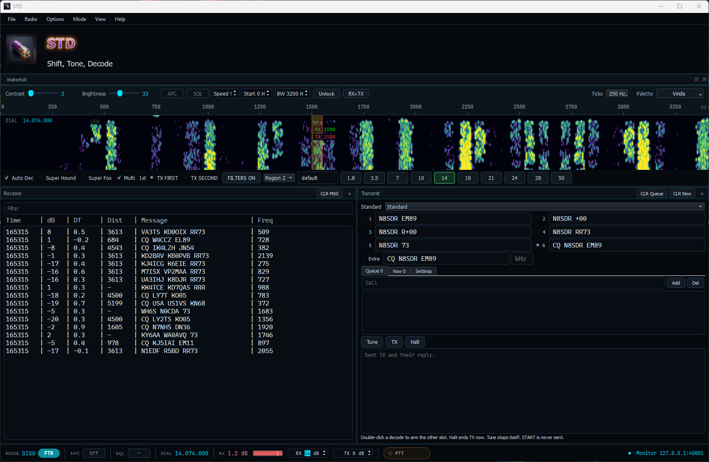
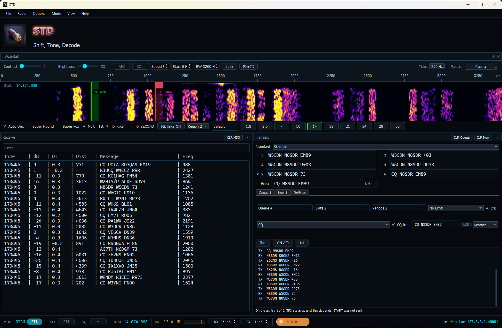
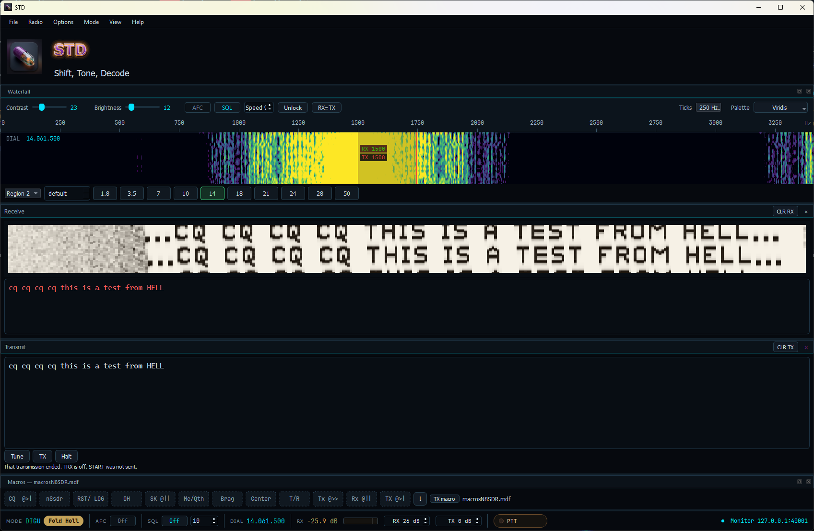

**Shift, Tone, Decode.** Software in testing. Version 0.1.0.

The name is the joke, and the joke is the release plan. STD is a Qt 6 digimode console for a TCI radio, currently in the contagious stage: it keys on the bench, it has not finished making the rounds, and the recommended treatment is another shot of bourbon while the modes get proved on the air.

**STD: Help keep the infections spreading and buy us a shot of bourbon.**

[☕ Donate via PayPal](https://www.paypal.com/donate/?business=NP2ZQS4LR454L&no_recurring=0&item_name=STD%3A+Help+keep+the+infections+spreading+and+buy+us+a+shot+of+bourbon.&currency_code=USD)

Copyright (C) 2026 Rick Langford (N8SDR). License: [GPL-3](https://github.com/N8SDR1/STD/blob/main/COPYING). Source: [N8SDR1/STD](https://github.com/N8SDR1/STD).

## Screenshots

These pictures are copied from [screenshots/landingpage](https://github.com/N8SDR1/STD/tree/main/screenshots/landingpage). Add a PNG there and it can be copied onto this site.

## Modes that key

TX sends one of these when the operator presses TX or Tune. Opening the radio does not key. The text command START is never sent. The full list, with the rows that are still absent, is on the [modes](modes.html) page.

| Mode | What this build sends |
| --- | --- |
| FT8, FT4, FT2 | 15 s, 7.5 s, and 3.75 s. DIGU. MSHV generator. |
| Hell | Feld, Slow, X5, X9, FSK, FSK-105, and Hell 80, each at its Fldigi column rate. See [Hell](hell.html). |
| RTTY | One row. 45.45 baud, 170 Hz, mark high. |
| BPSK | PSK31, 63, 125, 250, 500, 1000. |
| Olivia and Contestia | 4/250, 8/250, 8/500, 16/500, 16/1000, 32/1000. |
| MFSK | 4, 8, 11, 16, 22, 31, 32, 64, 128. |
| DominoEX | 4, 5, 8, 11, 16, 22. FEC off. |
| Thor | 4, 5, 8, 11, 16, 22. K=7. |

## Receive only

**WEFAX-576** receives (IOC 576, 120 lines per minute). It does not key, and it does not send START.

## Still in progress

**MT63** (500, 1000, and 2000 Hz, short and long) is not on the menu and does not key. **QPSK** and **8PSK** are not in this build. CW stays in Lyra.

JS8Call is later ([JS8Call-improved](https://js8call.com/JS8Call-improved/)). FLD-88 is queued.

## Macros

The RST/LOG macro does not log. Fldigi's `<LOG>` tag is not implemented, so that button only inserts text. Details are on the [macros](macros.html) page.

## Connect

Connect sends `AUDIO_START:0`. Disconnect sends `AUDIO_STOP:0`. The text command START is never sent. `trx` goes out only when the operator presses TX or Tune. See [connect](connect.html).

Qt on Windows is 6.11.1 MSVC (`C:\Qt\6.11.1\msvc2022_64`).
